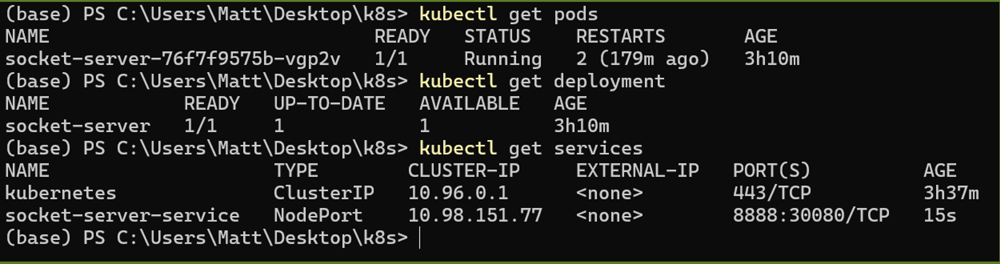
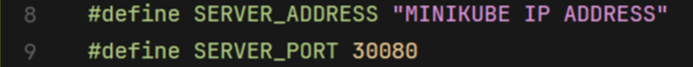

# Task 1: Launching K8s and deploy our containers

## Launching Kubernetes and Deploying Containers
### 1. Start the Kubernetes cluster
```bash
minikube start --driver=podman
```

### 2. Export the Podman image and load it into Minikube
```bash
podman save -o server.tar localhost/server-<your_student_id>:latest
minikube image load server.tar
```
## Deploy the Application
### 1. Modify the deployment configuration
Enter the k8s folder, open deployment.yaml, and modify the image to match your student ID. You can run `minikube image ls` to verify the exact image name stored inside Minikube.
```YAML
containers:
      - name: socket-server
        image: localhost/server-<your_student_id>:latest
        imagePullPolicy: Never
```
### 2. apply configurations       
```bash
kubectl apply -f deployment.yaml
kubectl apply -f service.yaml
```

### 3. Check the status of your deployment
```bash
kubectl get pods
kubectl get deployment
kubectl get services
```
<div class="warning">
    <strong>Note:</strong> You need to include the screenshot of the command output above in your report. <strong>(5 points)</strong>
</div>



## (Optional) Check if your container is running correctly on the minikube
### 1. Get the ip address of the minikube:
```bash
minikube ip
```

### 2. Open and modify the `PLEASE ASSIGN` section in `docker/client/socket_client.c`. (Assign your actual minikube ip to `SERVER_ADDRESS`):


### 3. Build and run the client container.

