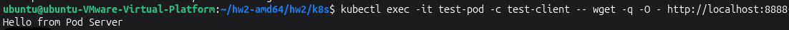

# Task 2: Deploy our Pods

## 1. Deploy the generated Pod into the cluster

### 1. Export Podman Pod to Kubernetes YAML
```bash
podman generate kube test-pod > test-pod.yaml
```

### 2. Remove Local Podman Pod to Free Up Ports
```bash
podman pod rm -f test-pod
```

### 3. Apply YAML and Deploy to Minikube
```bash
kubectl apply -f test-pod.yaml
```

### 4. Check the Pod Status in Kubernetes
```bash
kubectl get pods
```

### 5. Test Inter-Container Communication via Localhost

        
```bash
kubectl exec -it test-pod -c test-client -- wget -q -O - http://localhost:8888
```
<div class="warning">
    <strong>Note:</strong> You need to include the screenshot of the command output above in your report. <strong>(5 points)</strong>
</div>


## 2. Answer the following questions and include the answers in your report:
- What is Kubernetes? Why do we need it? ***(5 points)***
- Please explain the concepts of `Deployment`, `Service` and `Pod`. ***(5 points)***
- Why k8s use pod to manipulate the application instead of the container. ***(5 points)***
- What is `Replica Set` in Kubernetes? ***(5 points)***
- Why can the client successfully communicate through port 30080 when the server is listening on port 8888? ***(10 points)***

## Tear down the deployed services and minikube cluster after you finished testing:
```bash
kubectl delete -f service.yaml
kubectl delete -f deployment.yaml
kubectl delete -f test-pod.yaml
minikube stop
```
