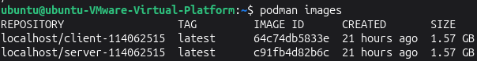
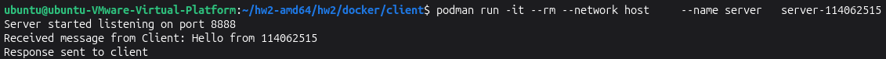
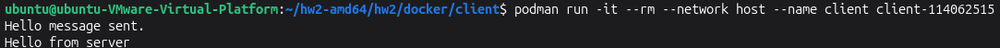

# Task 1: Building the images

### 1. Enter the client folder, open and modify the `PLEASE ASSIGN` section and append your student ID in `socket_client.c` as shown in the following image:


### 2. Build the image with the Dockerfile
```bash
cd path/to/server
podman build -t server-<your_student_id> .
```
```bash
cd path/to/client
podman build -t client-<your_student_id> .
```
> **Troubleshooting :**
> If you encounter the error `Error: creating build container: short-name "gcc:15" did not resolve to an alias...`, it means Podman's default registry is not configured. You can fix this by changing the `FROM` instruction in your Dockerfile to use the full path: `FROM docker.io/library/gcc:15`


You can use the following command to check images you've built:
```bash
podman images
```


<div class="warning">
You need to submit the screenshot of the list of your images. <strong>(5 points)</strong>
</div>




### 3. Launch the server container first, and then launch the client container:
```bash
podman run -it --rm --network host \
    --name server \
    server-<your_student_id>
podman run -it --rm --network host \
    --name client \
    client-<your_student_id>
```
The command `podman run` will create the container instance with the image and execute the container.

<div class="warning">
You need to submit the screenshot of the output of the server and client containers. <strong>(5 points)</strong>
</div>



